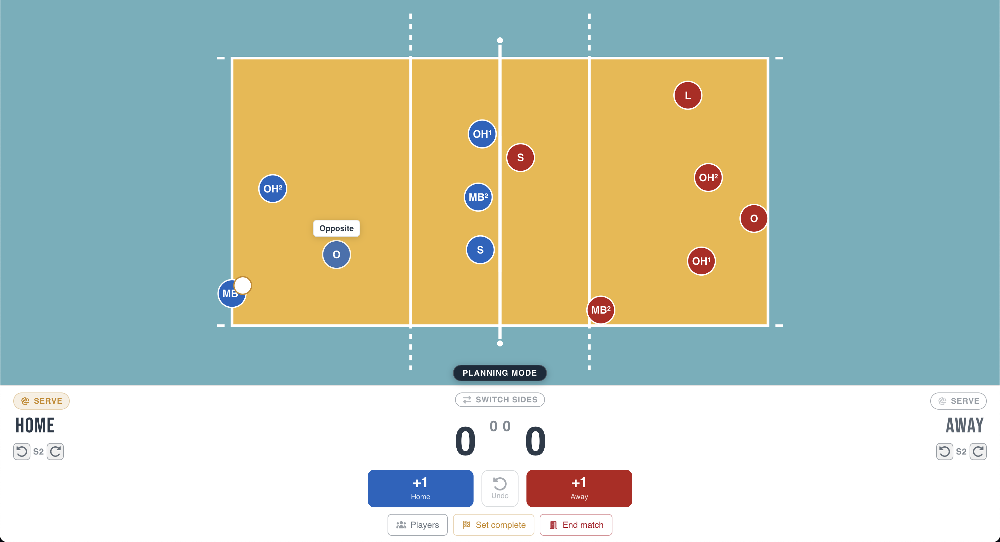
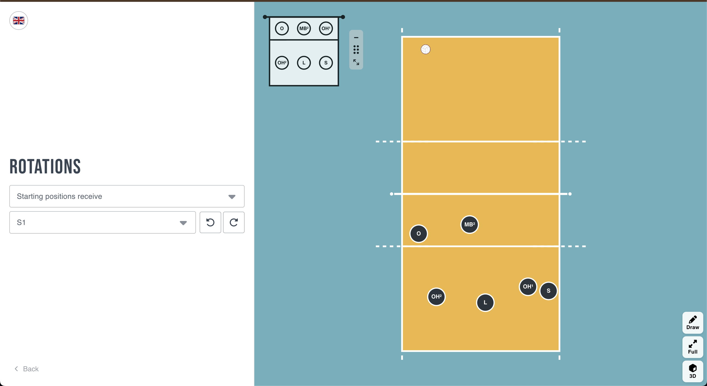
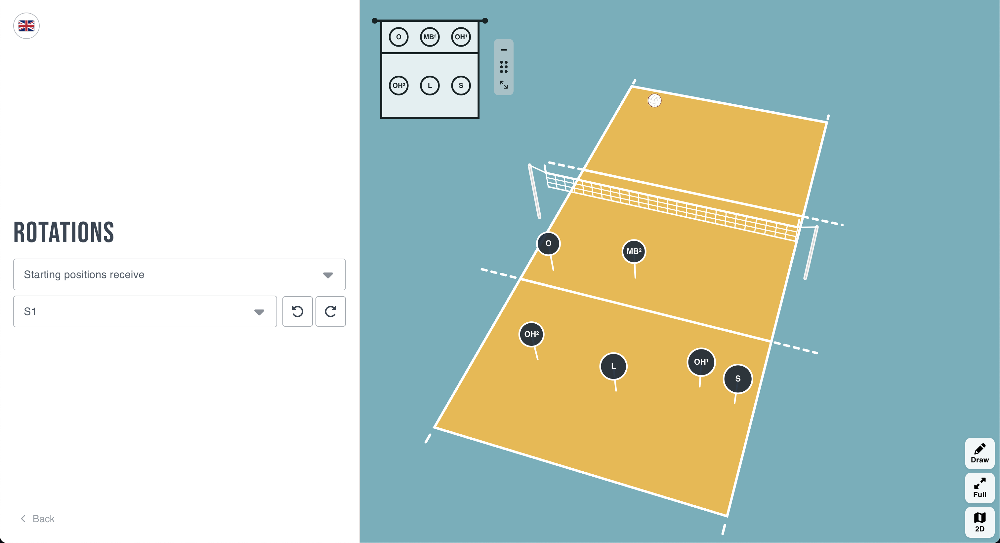
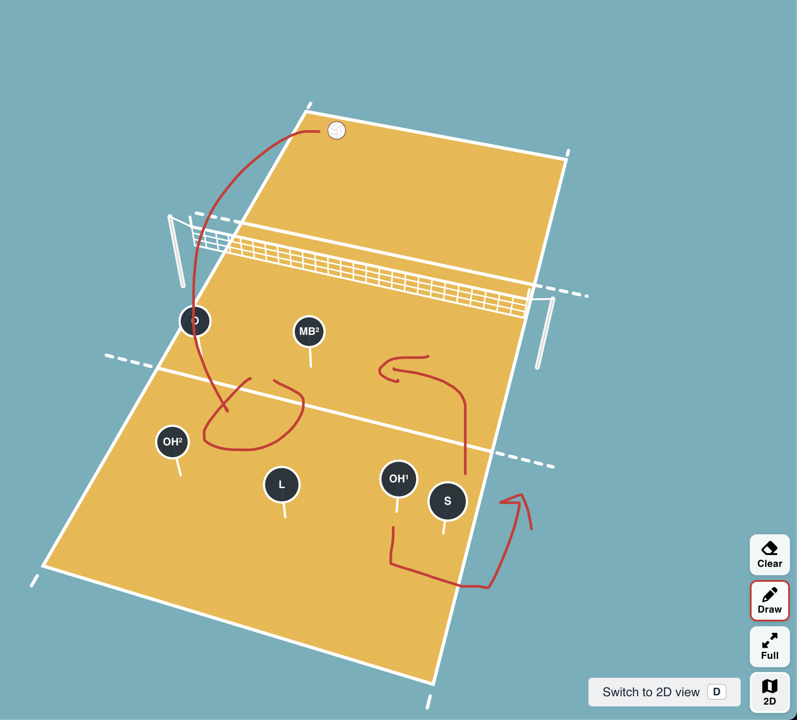

# Volley Rotations

A friendly little helper for learning volleyball rotations and keeping track of who's on court during a game.

**Try it here: https://volley-rotations.fallberg.dev/**

## Play

Add your players, put them on court and keep score. The app follows the serve and rotates your team for you, so you always know who's up next.

## 2D and 3D

Step through the rotations and see where everyone lines up. Look at the court from above, or switch to 3D and spin it around.

## Draw on the court

Sketch runs and arrows straight onto the court when you're explaining something to your team.

